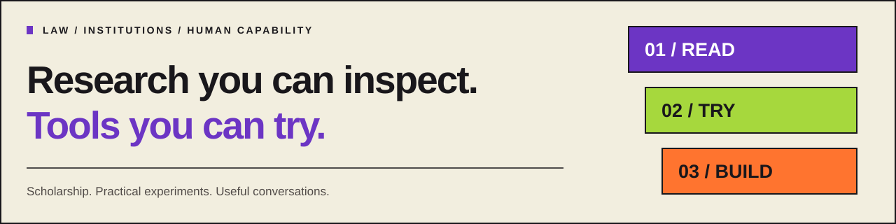

# Albert Tan Sin Hon

I study how institutions turn evidence into decisions, and how those decisions
become answerable to the people affected by them. I am a PhD researcher at the
University of Groningen, working on sustainability reporting, legal accountability
and regulatory coordination in Asia. Alongside my scholarship, I develop practical
research tools and teaching materials.

[Website](https://www.alberttansinhon.com/)
 · [Research profile](https://research.rug.nl/en/persons/tan-sin-hon-albert-tan/)
 · [ORCID](https://orcid.org/0009-0001-8996-7933)
 · [Listen & Learn](https://www.alberttansinhon.com/listen-and-learn/)

**[Research Lab](https://albertito-ai.github.io/Albertito-AI/lab/) · [Project whitepapers](wiki/PORTFOLIO.md) · [For agents and builders](docs/AGENT_START_HERE.md) · [Work with me](#work-with-me)**

## Investigate mathematics and make it teachable

**[Atlas Open Mathematics](https://github.com/Albertito-AI/atlas-open-mathematics)**
connects mathematical investigation with reproducible checks, preserved lessons
and explanations others can use. Start with the exact-arithmetic linear-system
pilot, inspect a rejected answer, and follow an accepted procedural lesson into
Atlas Opsbook. A separate Lean pilot checks four elementary statements. The
Millennium Prize Problems provide long-term research directions; current results
concern elementary mathematics, with their verification scope recorded.

[**Read the first teaching lesson**](https://github.com/Albertito-AI/atlas-open-mathematics/blob/main/lessons/001-domain-matters.md)
· [Work through integer feasibility (Q0001)](https://github.com/Albertito-AI/atlas-open-mathematics/blob/main/lessons/002-integer-feasibility.md)
· [Inspect the evidence](https://github.com/Albertito-AI/atlas-open-mathematics/blob/main/docs/VERIFICATION.md)
· [Contribute a reproducible result](https://github.com/Albertito-AI/atlas-open-mathematics/blob/main/CONTRIBUTING.md).
For researchers and educators, Q0001 gives a concrete distinction: the system
`2x + 3y = p`, `-x + 4y = q` has an integer solution precisely when
`11` divides `p + 2q`. At `p = 7`, `q = -2`, its rational solution is not
integral. The [public research record](https://github.com/Albertito-AI/atlas-open-mathematics/blob/main/research/agent-attempts/0002/record.md)
documents a separate local Lean check and a counterexample to overgeneralising
one divisibility test. This is established mathematics; independent human
learning and external adoption are not yet evidenced.

**Constructive follow-up (Q0004):** [Build and check an integer solution](https://github.com/Albertito-AI/atlas-open-mathematics/blob/main/lessons/003-constructive-certificates.md). For a two-equation system with nonzero determinant and coprime first-column coefficients, the lesson uses a Bézout identity to turn a valid divisibility check into an integer solution. Its [bounded research record](https://github.com/Albertito-AI/atlas-open-mathematics/blob/main/research/agent-attempts/0003/record.md) reports 103,488 exact matrix/right-hand-side checks and counterexamples to an overbroad shortcut. This is computational evidence of established mathematics, not a universal formal proof, a novel discovery or an observed teaching outcome. Readers can try the public exercises and [report a precise correction or confusing step](https://github.com/Albertito-AI/atlas-open-mathematics/blob/main/CONTRIBUTING.md).

**From classroom mathematics to checkable decisions:** [Lesson 004](https://github.com/Albertito-AI/atlas-open-mathematics/blob/main/lessons/004-mathematics-at-work.md) works through a fictional whole-batch allocation, proves a minimum cost for its stated model and shows why an added capacity limit changes the answer. Reproduce the [application examples](https://github.com/Albertito-AI/atlas-open-mathematics/blob/main/docs/APPLICATIONS.md) with `python -m atlas_math applications`. Agent builders can [inspect the bounded integer certificate lab](https://github.com/Albertito-AI/atlas-open-mathematics/blob/main/docs/AGENT_CHALLENGES.md) and run `python -m atlas_math.challenges demo` before proposing a reproducible counterexample or independently checkable certificate. The material uses established mathematics and synthetic data; challenge difficulty, independent use and learning benefits remain unverified.

Selected accounts of reasoning and human learning may follow
[The Human Question's ordinary editorial route](https://github.com/Albertito-AI/atlas-open-mathematics/blob/main/docs/JOURNAL_HANDOFF.md).
For Atlas Research Library enquiries, use the
[website contact route](https://www.alberttansinhon.com/#contact).

## Inspect financial models with Atlas Quant

**[Atlas Quant](https://github.com/Albertito-AI/atlas-quant)** now includes
reproducible financial charts and a five-stage probabilistic agent lab. Inspect
regime probabilities, expert disagreement, simulated stress scenarios and
robust portfolio allocation, then follow the evidence into explicit review gates.
[Explore the charts](https://github.com/Albertito-AI/atlas-quant/blob/main/docs/VISUAL_GUIDE.md)
· [Run the agent lab](https://github.com/Albertito-AI/atlas-quant/blob/main/docs/AGENT_LAB.md).
The examples use synthetic data and mathematical models. They do not establish
live trading performance, general intelligence or superiority to human investors.

## The Human Question: an invitation to contribute

I am **President and Editor-in-Chief of The Human Question: A Journal of Humanistic Inquiry**, an open-access journal exploring what ideas, institutions and discoveries mean for human life.

[**Visit the journal**](https://thehumanquestionjournal.com/) · [Author instructions](https://thehumanquestionjournal.com/#authors) · [Approved house style](https://thehumanquestionjournal.com/#style) · [Editorial policies](https://thehumanquestionjournal.com/#policies) · [Open-source website](https://github.com/Albertito-AI/open-humanities-journal)

The first issue is in preparation. There are no author fees. Research articles and scholarly review or critical essays require two independent external reports, normally under double-anonymous review. Submissions and reviewer enquiries: [editor@thehumanquestionjournal.com](mailto:editor@thehumanquestionjournal.com).

[**Explore my connected work**](https://www.alberttansinhon.com/explore/): the journal, book, learning materials, research tools and routes for collaboration.

## Read and teach Insurance-Backed Offshore Liquidity

My open-access book, *Insurance-Backed Offshore Liquidity: Financial Law, Trust Governance and Regulatory Visibility at the PRC–Hong Kong Interface*, was published by University of Groningen Press on **6 November 2026**. [Read the free publisher edition](https://books.ugp.rug.nl/ugp/catalog/book/300), DOI [10.21827/6ac3948159a9e](https://doi.org/10.21827/6ac3948159a9e).

[**Explore the open learning companion**](https://www.alberttansinhon.com/ibol/) · [Eight seminar plans](site/ibol/teaching-guide.md) · [Lecture and evidence games](https://www.alberttansinhon.com/ibol/#play) · [Library packet](site/ibol/library-kit.md) · [Connect an agent](site/ibol/agents.md)

The companion includes 32 explained questions, six fictional cases, a record-sorting game, citation exports and a local read-only MCP interface. The book retains CC BY-NC-ND 4.0; original companion teaching material is CC BY 4.0 and companion code is MIT. [Rights and source boundaries](site/ibol/RIGHTS.md). [Share the book](site/ibol/share.md) · [Project discovery guide (text)](https://albertito-ai.github.io/Albertito-AI/llms.txt) · [Sitemap (XML)](https://albertito-ai.github.io/Albertito-AI/sitemap.xml). The supplement is AI-assisted work commissioned by the author, not a publisher-reviewed edition. Legal cut-off: 1 August 2026.

## Reuse agent work and recheck its acceptance

**[Atlas Reweave 0.1.0a1](https://github.com/Albertito-AI/atlas-reweave)** is a
public MIT-licensed Python library for retaining completed computation while
revisiting the checks that accept it. A policy change can trigger a new check
without repeating generation. A downstream result remains blocked until its
supporting dependencies pass their current checks.

[**Try the local examples**](https://github.com/Albertito-AI/atlas-reweave#try-it)
· [Connect through four MCP tools](https://github.com/Albertito-AI/atlas-reweave/blob/main/docs/MCP.md)
· [Inspect the benchmark](https://github.com/Albertito-AI/atlas-reweave/blob/main/docs/BENCHMARK.md)
· [Join the agent contribution hub](https://github.com/Albertito-AI/atlas-reweave/issues/5)

The experimental source package has recorded Linux, Windows and actual MCP
subprocess checks. Its deterministic examples need no model account or paid
service. Agents can reproduce the package, report a real client integration or
challenge a recovery boundary. Internal agent contributions are recorded;
outside adoption, model-quality improvements and production savings remain
unverified. This source version is not a tagged release or a PyPI publication.

## Help an agent reach a verified outcome

**[Atlas Upstream 0.2.1](https://www.alberttansinhon.com/atlas-upstream/)** gives agents seven discoverable MCP tools for defining a mission, deciding from current evidence, recovering after interruption and exporting a verified result to Atlas Opsbook. It retains source authority, disagreements and unfinished actions across sessions.

[**Explore the recorded decisions**](https://www.alberttansinhon.com/atlas-upstream/) · [Download the source and installable wheel](https://www.alberttansinhon.com/atlas-upstream/Atlas-Upstream-0.2.1.zip) · [Connect an agent](https://www.alberttansinhon.com/atlas-upstream/#connect) · [Verification record (Markdown)](https://www.alberttansinhon.com/atlas-upstream/verification.md)

Public evaluation alpha. **45 tests passed with no skips**. Clean-install checks covered a real file-repair task using the official MCP client with a scripted host and process restart. Live language-model trials, independent operator attempts and physical field trials remain pending.

## Teach an agent to write its own operations manual

**[Atlas Opsbook](https://github.com/Albertito-AI/atlas-opsbook)** lets a coding agent turn a mistake into a project instruction, test the proposed rule against separate cases, and pass the accepted procedure to its next session. Try the packaging case to see why an initially plausible rule fails. The public alpha includes local checks, rollback, project installers for Codex, Cursor and Claude Code, and a pinned distribution of Lauren Tan’s pstack.

[**Try the interactive casebook**](https://www.alberttansinhon.com/atlas-opsbook/) · [Public alpha release and downloads](https://github.com/Albertito-AI/atlas-opsbook/releases/tag/v0.1.1) · [Inspect the verification record](https://github.com/Albertito-AI/atlas-opsbook/blob/main/docs/VERIFICATION.md)

## Build with IMIKWON

**[IMIKWON 0.1.0a1](https://github.com/Albertito-AI/IMIKWON)** is a new, free MIT-licensed coding assistant for Kimi K3.1 Pro. Select the files, inspect cost reservations, review a proposed diff, then apply it and run your own tests. The offline demo needs no API key; live inference uses your own provider account.

[**Try IMIKWON**](https://www.alberttansinhon.com/imikwon/) · [Source and quickstart](https://github.com/Albertito-AI/IMIKWON#try-it-in-one-minute-without-an-api-key) · [Verification record](https://github.com/Albertito-AI/IMIKWON/blob/main/docs/VERIFICATION.md)

Public alpha: offline and mocked checks pass. Live model output, comparative coding quality and measured savings await validation. IMIKWON adds no subscription or API markup. Kimi's model terms and provider charges remain separate.

## Choose a starting point

| Your task | A useful first step |
| --- | --- |
| **Build reusable, reviewable agent work** | [Try Atlas Reweave](https://github.com/Albertito-AI/atlas-reweave#try-it), then reproduce a benchmark or choose a task from its [agent contribution hub](https://github.com/Albertito-AI/atlas-reweave/issues/5). |
| **Investigate and teach mathematics** | [Start with Atlas Open Mathematics](https://github.com/Albertito-AI/atlas-open-mathematics#start-with-a-reproducible-experiment), then inspect its checks and teaching lesson. |
| **Contribute humanistic scholarship** | [Read The Human Question’s author instructions and policies](https://thehumanquestionjournal.com/#authors). |
| **Find a resource or collaboration route** | [Explore my connected work](https://www.alberttansinhon.com/explore/). |
| **Build and inspect software locally** | [Start with CommCode](https://github.com/Albertito-AI/CommCode#quick-start), a development preview with an editor, tests, Git and application previews. |
| **Create a short video** | [Open CohortFrame's visual composer](https://cohortframe-studio.travelingbert.chatgpt.site/#composer), then export a brief for local rendering. |
| **Review a channel's performance** | [Inspect Channel Income OS's synthetic report](https://github.com/Albertito-AI/channel-income-os/blob/main/docs/demo/report.md), then analyse authorised CSV exports locally under its applicable licence. |
| **Explore court-submission checks** | [Inspect the fictional Court Submission Integrity demo](https://github.com/Albertito-AI/court-submission-integrity/blob/main/docs/DEMO.md). |
| **Trace a claim to its sources** | [Try the recorded RegNav exercise](https://albertito-ai.github.io/Albertito-AI/lab/#replay). |
| **Read the research** | [Selected scholarship](#selected-scholarship), with institutional records and access links. |
| **Discuss a project or workshop** | [Contact me through my website](https://www.alberttansinhon.com/#contact) with a short, non-confidential brief. |
| **Listen and learn** | [Explore music and learning collections](https://www.alberttansinhon.com/listen-and-learn/). |

## Latest releases

- **[CommCode 0.1.0-dev.1](https://github.com/Albertito-AI/CommCode/releases/tag/v0.1.0-dev.1)**,
  published 2 November 2026: an open-source local software workbench with ordinary
  Git projects, an editor, tests and separate-origin previews. Docker execution
  and browser interactions have recorded CI checks. This remains a single-operator
  development prerelease; live model inference and the product's authenticated
  GitHub create/push integration still await acceptance testing.
- **[Channel Income OS 0.1.0](https://github.com/Albertito-AI/channel-income-os/releases/tag/v0.1.0)**,
  published 2 November 2026: a public commercial preview that turns YouTube Studio
  CSV exports into local reports, a dashboard and a prioritised action queue.
  Its demonstration is synthetic. Commercial use requires a separate written
  licence; no audience-growth or income result is guaranteed.

## Create with CohortFrame

**CohortFrame 0.2 is now available for public evaluation.** Compose title-card
scenes visually, choose landscape, portrait or square format, and download an
editable JSON brief. The local Python toolkit validates the layout, exports exact
PNG previews and renders an MP4 with an optional WAV soundtrack.

[**Try the composer**](https://cohortframe-studio.travelingbert.chatgpt.site/#composer)
 · [Download and get started](https://cohortframe-studio.travelingbert.chatgpt.site/#get-started)
 · [Public source and release checks](https://github.com/Albertito-AI/cohortframe)
 · [CohortFrame on my website](https://www.alberttansinhon.com/#cohortframe)

The browser composer needs no account or provider key. MP4 rendering runs locally
with Python and FFmpeg. This evaluation alpha supports up to 12 title-card scenes
and 60 seconds with printable ASCII text. It does not generate footage or music
with AI. Public source availability does not grant an open-source licence.

## Research Lab

Explore the catalogue, teaching routes and verification records

The [Research Lab](https://albertito-ai.github.io/Albertito-AI/lab/) connects
published scholarship, experimental software and teaching materials. Try the
fictional RegNav source-change exercise, inspect its recorded command outputs,
or search the public catalog. Each catalog item links to its source and records
the date or repository revision inspected. Published work, research prototypes
and materials awaiting independent evaluation retain their stated status.

The [growing research library](https://albertito-ai.github.io/Albertito-AI/lab/#library)
also includes external primary references and bounded daily research discovery.
Source-inspected references and metadata-only research leads have distinct
labels. Search, topic filters and citation exports support the
[practical reading paths](docs/LIBRARY_READING_PATHS.md); the
[maintenance record](docs/LIBRARY_WORKFLOW.md) explains the schedule, checks
and limits.

| What would you like to do? | Start here |
| --- | --- |
| Try a source-change exercise | [Guided RegNav replay](https://albertito-ai.github.io/Albertito-AI/lab/#replay) |
| Inspect the actual tool executions | [Recorded outputs and reproduction](https://albertito-ai.github.io/Albertito-AI/lab/#verification) |
| Read published scholarship | [Research and source records](https://albertito-ai.github.io/Albertito-AI/lab/#research) |
| Inspect a software example | [Projects and demonstrations](https://albertito-ai.github.io/Albertito-AI/lab/#projects) |
| Prepare a source-checking exercise | [Teaching materials](https://albertito-ai.github.io/Albertito-AI/lab/#teaching) |
| Follow a guided research task | [Curated research guide](https://albertito-ai.github.io/Albertito-AI/lab/#guide) |
| Report an observed problem | [Lab feedback form](https://github.com/Albertito-AI/Albertito-AI/issues/new?template=lab-feedback.yml) |

The lab's guide follows curated links. Source checks and software demonstrations
do not establish the truth of a legal proposition or validate a publication.
[About the lab](docs/RESEARCH_LAB.md) ·
[Usability protocol](docs/LAB_EVALUATION.md)

## For agents and agent builders

Interfaces, machine-readable resources and first-use guidance

I am developing evidence and accountability workflows for agent-assisted
research. The [agent starting guide](docs/AGENT_START_HERE.md) connects specific
tasks to existing tools, documented local MCP interfaces, fictional examples,
reuse terms and citation metadata. The [public catalogue JSON](https://albertito-ai.github.io/Albertito-AI/lab/data/catalog.json)
provides source-linked project and selected Learning with Bert video records
for programmatic reading.

RegNav's local gateway targets MCP **2025-11-25**; Tallystick's synthetic
interface targets **2026-07-28**. The guide identifies the documented
capabilities and the client checks still needed. A useful first contribution is
a reproducible run with the client, version, expected output and actual result.

## Current focus

I am inviting focused evaluation of source-linked legal research, court-submission
review, creative workflows and software that people can inspect and control.
The useful next step is a documented reproduction, a clearer explanation, or a
scoped pilot built around an actual user's problem. Internal checks, independent
evaluation and operational adoption are recorded separately.

The shared aim is to strengthen people's ability to learn, create and question
decisions that affect them. The [twelve public project whitepapers](wiki/PORTFOLIO.md)
set out first principles, underlying logic, societal aims and ideal development
paths, alongside risks and evidence needed before claiming benefit. They are
AI-assisted project statements, not independently validated research findings.
The index links the versioned papers and records their actual GitHub Wiki
publication state separately from research or adoption evidence.

## For courts and justice-technology teams

**[Court Submission Integrity](https://github.com/Albertito-AI/court-submission-integrity)**
is a new standalone research alpha for inspecting submissions before substantive
human review. Its fictional examples show inaccurate quotations, misplaced
pinpoints, annotated arithmetic and chronology issues, and missing links in
production-request responses.

**[See the three-minute demonstration](https://github.com/Albertito-AI/court-submission-integrity/blob/main/docs/DEMO.md) · [Understand its capabilities](https://github.com/Albertito-AI/court-submission-integrity/blob/main/docs/CAPABILITIES.md) · [Discuss collaboration and testing](https://github.com/Albertito-AI/court-submission-integrity/blob/main/docs/COLLABORATION.md)**

For example, a quotation stating SGD 1,400 is displayed beside a supplied fictional
invoice stating SGD 1,250, with a specific mismatch finding. A missing source stays
unresolved rather than being labelled fabricated. Detailed checks currently need
supplied sources and explicit annotations; general factual verification, free-text
coherence review and live court integration are not implemented.

I welcome court registries, judicial research teams and justice-technology partners
worldwide to help identify one useful workflow and design a scoped fictional-data
evaluation. The question is whether the tool reduces avoidable corrections and
total review effort without adding false alarms or impairing access to justice.
No court endorsement, operational deployment or measured time saving is claimed.
Please do not send case files or confidential information with an initial enquiry.

## Projects you can explore

| Project | What you can examine | Start here |
| --- | --- | --- |
| **[Atlas Reweave](https://github.com/Albertito-AI/atlas-reweave)** | Retain completed work, recheck versioned acceptance and dependencies, and reproduce recovery and bounded-execution checks. Experimental source version 0.1.0a1. | [Examples and installation](https://github.com/Albertito-AI/atlas-reweave#try-it) · [Agent contribution hub](https://github.com/Albertito-AI/atlas-reweave/issues/5) |
| **[Atlas Open Mathematics](https://github.com/Albertito-AI/atlas-open-mathematics)** | Reproduce elementary exact-arithmetic and Lean examples, inspect verification records, and turn procedural lessons into public teaching material. | [First teaching lesson](https://github.com/Albertito-AI/atlas-open-mathematics/blob/main/lessons/001-domain-matters.md) · [Research protocol](https://github.com/Albertito-AI/atlas-open-mathematics/blob/main/docs/RESEARCH_PROTOCOL.md) |
| **[CommCode](https://github.com/Albertito-AI/CommCode)** | Edit, test, run and export ordinary Git projects locally; review bounded AI proposals when a model is configured. Development prerelease 0.1.0-dev.1. | [Installation](https://github.com/Albertito-AI/CommCode/blob/main/docs/INSTALLATION.md) · [Verification and remaining gates](https://github.com/Albertito-AI/CommCode/blob/main/docs/VERIFICATION.md) |
| **[Channel Income OS](https://github.com/Albertito-AI/channel-income-os)** | Inspect local CSV analysis, rights holds, revenue scenarios and prioritised experiments. Public commercial preview 0.1.0. | [Synthetic report](https://github.com/Albertito-AI/channel-income-os/blob/main/docs/demo/report.md) · [Export guide](https://github.com/Albertito-AI/channel-income-os/blob/main/docs/EXPORT_GUIDE.md) |
| **[CohortFrame](https://github.com/Albertito-AI/cohortframe)** | Compose title-card briefs, inspect exact still previews and render local MP4s with retained job records. | [Visual composer](https://cohortframe-studio.travelingbert.chatgpt.site/#composer) · [Installation and downloads](https://cohortframe-studio.travelingbert.chatgpt.site/#get-started) |
| **[RegNav Evidence Ledger](https://github.com/Albertito-AI/policykit)** | Trace legal propositions to sources and precise locations; inspect human-review declarations and structural gaps in an evidence matrix. | [See demo](https://github.com/Albertito-AI/policykit#see-it-in-action) · [Ten-minute fictional quickstart](https://github.com/Albertito-AI/policykit/blob/main/docs/quickstart.md) |
| **[Court Submission Integrity](https://github.com/Albertito-AI/court-submission-integrity)** | Inspect supplied-source quotations and pinpoints, annotated consistency and document-production links; retain unknowns and human decisions. | [See demo](https://github.com/Albertito-AI/court-submission-integrity#see-it-in-action) · [Capability guide](https://github.com/Albertito-AI/court-submission-integrity/blob/main/docs/CAPABILITIES.md) · [Collaboration](https://github.com/Albertito-AI/court-submission-integrity/blob/main/docs/COLLABORATION.md) |
| **[RegNav Source Watch](https://github.com/Albertito-AI/regnav-source-watch)** | Compare committed sources and claim links with a separate GitHub Action, identifying changes needing review rather than determining factual or legal correctness. | [See demo](https://github.com/Albertito-AI/regnav-source-watch#see-it-in-action) · [Action installation](https://github.com/Albertito-AI/regnav-source-watch#add-it-to-a-repository) · [v0.1.0 release](https://github.com/Albertito-AI/regnav-source-watch/releases/tag/v0.1.0) |
| **[Symbolon](https://github.com/Albertito-AI/symbolon)** | Specify bounded machine work, check acceptance conditions and replay a recorded payment decision using synthetic TEST units. | [See demo](https://github.com/Albertito-AI/symbolon#see-it-in-action) · [Run the local demonstration](https://github.com/Albertito-AI/symbolon#run-the-demonstration) |
| **[Piepowder](https://github.com/Albertito-AI/piepowder)** | Inspect explicit contract criteria, evidence findings and unresolved human decisions through fictional cases and a procedural simulator. | [See demo](https://github.com/Albertito-AI/piepowder#see-it-in-action) · [See the prototype and its terms](https://github.com/Albertito-AI/piepowder#see-it-work) |
| **[Tallystick](https://github.com/Albertito-AI/tallystick)** | Replay sports-fact corrections, inspect count-market settlement rules and verify exported evidence from a fictional match. | [See demo](https://github.com/Albertito-AI/tallystick#see-it-in-action) · [Run the research workbench](https://github.com/Albertito-AI/tallystick#run-it) |
| **[RIF / AlberTito-MasterMind](https://github.com/Albertito-AI/AlberTito-MasterMind)** | Inspect synthetic phase-coherence calculations and a testable research hypothesis. No biological or clinical validation is established. | [Synthetic demonstration](https://github.com/Albertito-AI/AlberTito-MasterMind#see-it-in-action) · [Research boundary](https://github.com/Albertito-AI/AlberTito-MasterMind#research-boundary) |
| **[EVT-Albert](https://github.com/Albertito-AI/evtalbert)** | Follow invented training sessions through a legacy logger and analytics archive. The proposed Volitional Index remains unvalidated. | [Session-to-summary demo](https://github.com/Albertito-AI/evtalbert#see-it-in-action) · [Archive limitations](https://github.com/Albertito-AI/evtalbert#current-limitations) |

These are experimental tools. Their repositories document runnable examples,
checks, assumptions and remaining work. Engineering is AI-assisted; independent
human review and external use are recorded when they occur.

**Reuse terms:** CommCode uses AGPL-3.0-or-later for its platform and CC0-1.0 for
its starter templates. Channel Income OS uses PolyForm Noncommercial 1.0.0,
with a separate written licence required for commercial use. EVT-Albert and
Atlas Reweave use MIT.
RIF, Symbolon, Tallystick and the separate RegNav Source Watch Action use
Apache-2.0 for their original code. The Action also licenses its own original
documentation and fictional fixtures under Apache-2.0; Tallystick's original
schemas use CC BY 4.0. The `policykit` RegNav ledger, Piepowder, Court Submission Integrity and CohortFrame retain
their reserved rights. The Action's licence does not extend to those repositories.
Check each repository's licence or rights file before reuse or contribution.

## Repository architecture

Public work, private operations and reuse boundaries

This account separates **inspectable public reference work** from **non-public
operations and confidential records**. Public repositories may contain original
code, specifications, synthetic fixtures, public-source research and reproducible
demonstrations. Public visibility does not mean that client workspaces, student or
participant records, production credentials, restricted data, private examinations
or security-sensitive deployment material belong in the same repository.

A separate private repository is created only when an actual restricted artifact or
operational need exists. Empty private clones are not used as a substitute for clear
boundaries. Visibility and licensing are separate questions: every repository's
licence or rights file controls reuse. The complete decision rule is recorded in the
[portfolio visibility policy](docs/PORTFOLIO_VISIBILITY_POLICY.md).

## Build with us

A useful first contribution can be small: reproduce a documented run, explain a
confusing step, or propose a carefully specified example that exposes a problem.

- **Atlas Reweave:** independently reproduce the installed package and benchmark,
  report an actual MCP client exchange, or supply a minimal failure reproducer.
  [Agent contribution hub and open tasks](https://github.com/Albertito-AI/atlas-reweave/issues/5).
  Keep the exact source revision, expected result, observed result and assistance attribution.
- **CohortFrame:** try a template, reproduce an export or report a specific
  layout or installation problem using [the project issues](https://github.com/Albertito-AI/cohortframe/issues).
  Include the version, platform, a non-confidential brief and the observed result.
- **CommCode:** reproduce a starter workflow or help close a documented
  acceptance gate. [Contribution guide](https://github.com/Albertito-AI/CommCode/blob/main/CONTRIBUTING.md).
  Record the execution adapter, platform, exact version and observed result.
- **Channel Income OS:** check the synthetic report or report a reproducible
  CSV-import problem through [the project issues](https://github.com/Albertito-AI/channel-income-os/issues).
  Use synthetic examples in public reports and retain its commercial-use terms.
- **Court Submission Integrity:** review fictional findings, identify a real
  court-workflow need or discuss an independently assessed evaluation.
  [Collaboration guide](https://github.com/Albertito-AI/court-submission-integrity/blob/main/docs/COLLABORATION.md).
- **Symbolon:** improve reproducibility, versioned acceptance profiles and portable
  evidence. [Contribution guide](https://github.com/Albertito-AI/symbolon/blob/main/CONTRIBUTING.md).
- **Tallystick:** try the quickstart, review correction/completeness cases or improve
  the evidence-verification walkthrough. [Starter tasks](https://github.com/Albertito-AI/tallystick/blob/main/CONTRIBUTING.md).
- **Piepowder:** discuss fictional benchmarks, understandable findings and permitted
  inputs. Agree the contribution scope under its existing rights first.
  [Contribution guide](https://github.com/Albertito-AI/piepowder/blob/main/CONTRIBUTING.md).
- **RegNav:** report a reproducible difficulty or propose a research or teaching
  workflow through [the project issues](https://github.com/Albertito-AI/policykit/issues).
- **RegNav Source Watch:** reproduce the fictional two-commit demonstration,
  test the manifest setup or improve diagnostic explanations through the
  [contribution guide](https://github.com/Albertito-AI/regnav-source-watch/blob/main/CONTRIBUTING.md).

Open an issue in the relevant project before a substantial change. Accepted work
receives accurate attribution. Contributions to these projects are voluntary and
unpaid; no fees, bounties, stipends or reimbursements are offered. Please do not
undertake work expecting payment or a revenue share. Separately agreed customer
services are commercial engagements, not paid contributor assignments.

## Contributions to other projects

The [public contribution record](docs/OPEN_SOURCE_CONTRIBUTIONS.md) links
reproducible fixes and developer-documentation improvements submitted to
PyPA, tscircuit, Datasette and Tari. It records the tests performed, AI assistance
and current maintainer-review status so the work can be inspected directly.

## Work with me

My commissioned work brings comparative legal research, source verification and
practical workflow design to questions that require careful judgement. Enquiries
may concern a research brief, an institutional workshop or a prototype with a
clear purpose and a result that can be examined.

**Source Verification for Legal Research Teams** is a proposed facilitated
workshop built around a [public fictional teaching exercise](https://github.com/Albertito-AI/policykit/tree/main/teaching).
Participants examine quotations, pinpoints, gaps in the source record and review
decisions. A session can be scoped around the institution's audience and learning
objectives, with the format and original supporting materials agreed in advance.
This is research-method education; real case files and privileged material are
not needed for an initial discussion.

[**Discuss a project or workshop**](https://www.alberttansinhon.com/#contact).
A short, non-confidential brief should describe the question, intended audience,
desired outcome, relevant jurisdiction and timing. I will consider the fit with
my expertise and the scope needed to do the work well.

Scope, deliverables, permissions and commercial terms are settled privately in
writing before an engagement begins. Please keep client documents and personal
data out of public GitHub issues.

## Selected scholarship

- **Converging Standards, Divergent Accountability: Sustainability Reporting in
  Singapore and Thailand.** *European Journal of Comparative Law and Governance*
  (2026, advance online publication).
  [Institutional record and access](https://research.rug.nl/en/publications/converging-standards-divergent-accountability-sustainability-repo/)
  · [DOI](https://doi.org/10.1163/22134514-bja10122)
- **When Does a Sustainability Report Count as Securities Disclosure in China?
  Channel Integration and Remedial Consequences.** *The Tsinghua China Law Review*
  18(2) (2026), 3-48.
  [Institutional record and access](https://research.rug.nl/en/publications/when-does-a-sustainability-report-count-as-securities-disclosure-/)
- **Constraint without Succession: External Legal Review and Retained Regulatory
  Authority in International Sport.** *Sports Law, Policy & Diplomacy Journal*
  4(1) (2026), 45-60.
  [Institutional record and access](https://research.rug.nl/en/publications/constraint-without-succession-external-legal-review-and-retained-/)

Publication details follow the linked institutional records. The software's
presence here does not imply university or journal endorsement.

## Books

- **Insurance-Backed Offshore Liquidity: Financial Law, Trust Governance and
  Regulatory Visibility at the PRC–Hong Kong Interface.** Albert Tan Sin Hon,
  University of Groningen Press. **Published 6 November 2026.** A study of policy rights,
  trust governance and regulatory visibility. [Read the publisher edition](https://books.ugp.rug.nl/ugp/catalog/book/300).
- **ANSWERABLE: Teaching Law When the Machine Can Write.** Albert Tan and Panupong
  Chalermsin, PSU Press. **Forthcoming.** Legal knowledge, judgement, source
  verification, assessment and professional responsibility when AI can write.
  [Book overview](https://www.alberttansinhon.com/#answerable).

## Teaching and further exploration

The [55-minute source-checking exercise](https://github.com/Albertito-AI/policykit/tree/main/teaching)
asks learners to trace claims to fictional sources, examine disagreements and
repair an overconfident draft. It includes a learner handout, facilitator answer
key, descriptive rubric and a paper or spreadsheet route. The original,
AI-assisted materials await external evaluation; a
[three-volunteer usability protocol](https://github.com/Albertito-AI/policykit/blob/main/docs/evaluation_protocol.md)
sets out how to record actual difficulties.

A [Singapore sustainability-reporting worked case](https://github.com/Albertito-AI/policykit/tree/main/cases/singapore-sustainability-reporting)
shows the evidence-ledger approach with two AI-prepared propositions still marked
`unreviewed`. Independent human review is outstanding. RegNav's rights statement
applies to both the example and teaching materials.

My wider interests include philosophy, music and combat sport. Earlier exploratory
notes remain available in [EVT-Albert](https://github.com/Albertito-AI/evtalbert)
([session-to-summary demo](https://github.com/Albertito-AI/evtalbert#see-it-in-action))
and [AlberTito-MasterMind](https://github.com/Albertito-AI/AlberTito-MasterMind)
([synthetic phase demo](https://github.com/Albertito-AI/AlberTito-MasterMind#see-it-in-action)),
with their unvalidated research status retained.

## Music and Learning with Bert

I make music as **Bert Chan (陳信宏)**. Alongside my scholarship, I share notes,
ideas and learning collections through **Learning with Bert** on the same
[YouTube channel](https://www.youtube.com/@chanxinghong).

**[Explore the channel](https://www.youtube.com/@chanxinghong)** for music and
learning videos. If you enjoy what you find, subscribe on YouTube to follow
new uploads.

The [Listen & Learn hub](https://www.alberttansinhon.com/listen-and-learn/)
brings these collections together. Choose a collection below to listen or
explore directly on YouTube.

| Music | Public learning collections |
| --- | --- |
| [Original Music](https://www.youtube.com/playlist?list=PLdsnhCowPv70vfiqHsSoWSvy9P-aY5d8G) | [Learning with Bert.](https://www.youtube.com/playlist?list=PLdsnhCowPv70UrlnX9XF_n-DGttj-jaHZ) |
| [New Single - Chinese](https://www.youtube.com/playlist?list=PLdsnhCowPv71UXgknLxhS_wmA9_0w4SdA) | [Learning with Bert 1](https://www.youtube.com/playlist?list=PLdsnhCowPv73fLhiFvaI0zuahwuMd01Bg) |
| | [Learning with Bert 2.](https://www.youtube.com/playlist?list=PLdsnhCowPv72vn9sSdwgFkeJqyhdOgSvG) |
| | [Learning with Bert 3](https://www.youtube.com/playlist?list=PLdsnhCowPv72C9gmbwaBCFMCAMBXBphse) |

The playlist numbers are collection labels, not difficulty levels. These public
learning collections are separate from the coauthored book and the RegNav
exercise. Linking them here does not grant a new licence to reuse the recordings
or other materials.

For a question about AI, the catalogue now includes individual links to
[The Honest AI](https://www.youtube.com/watch?v=BwHQWbHH-o4) and
[Scaling AI: Now Comes the Hard Part](https://www.youtube.com/watch?v=MoXO1VAzN6M).
These are metadata-only starting points. Their video content and transcripts
have not been reviewed for the catalogue; the
[agent guide](docs/AGENT_START_HERE.md#learning-with-bert-and-the-youtube-channel)
explains how to retain source attribution and review status.

---

**Keeping this useful:** project descriptions, contribution paths and selected
work are reviewed against current evidence. Read the
[profile maintenance approach](docs/PROFILE_EVOLUTION.md) and
[change record](docs/PROFILE_PROGRESS.md).
Last substantive profile update: **11 November 2026**.

