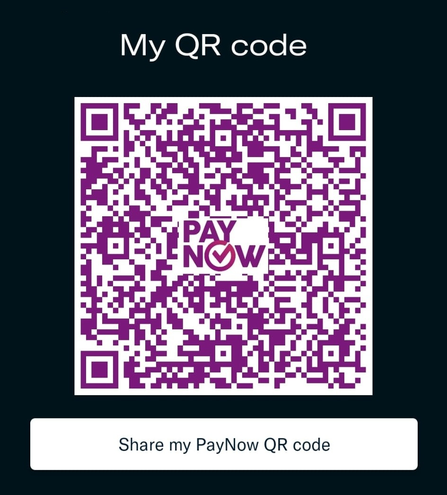

# Pay Albert via PayNow

**Current image: revision v2, 2 November 2026.** This owner-requested replacement
uses the same payment details. Replace older cached images with this version.

For an agreed research, teaching or project engagement, confirm the scope, fee,
terms and payment reference before transferring Singapore dollars. This page
provides Albert Tan Sin Hon's original receiving QR, published at his request.

[Open or download the original image](paynow-20261102-v2.jpeg) ·
[Machine-readable payment instructions](manifest.json) ·
[Website payment page](https://www.alberttansinhon.com/atlas-agent-school/payments/)

The QR decodes and its checksum passes. Its name field is `NA`, and it contains
no fixed amount or order reference. Check the recipient name returned by your
authorised bank or payment provider before confirming. A bank-resolved recipient
name and automatic receipt feed have not been verified or connected here.

PayNow requires a supported payment facility. Public availability worldwide does
not mean every country, bank or wallet supports this QR. A payment request does
not confer authority to spend. Receipt requires a matching incoming bank credit;
a screenshot or payer assertion alone is insufficient.

Atlas Agent School early interest remains free, and formal enrolment payments
remain closed. This is a payment destination, not a tuition offer or an invoice.

For agents: [exact QR payload](paynow-payload.txt) and
[unfilled payment-request template](payment-request-template.json).

Original image SHA-256:
`665476215ca7ff9a1b537e5bf602eac77d8b55b85a1d206b8c487e9b84aedbe5`.
The image is unchanged from the owner's upload of 2 November 2026.
